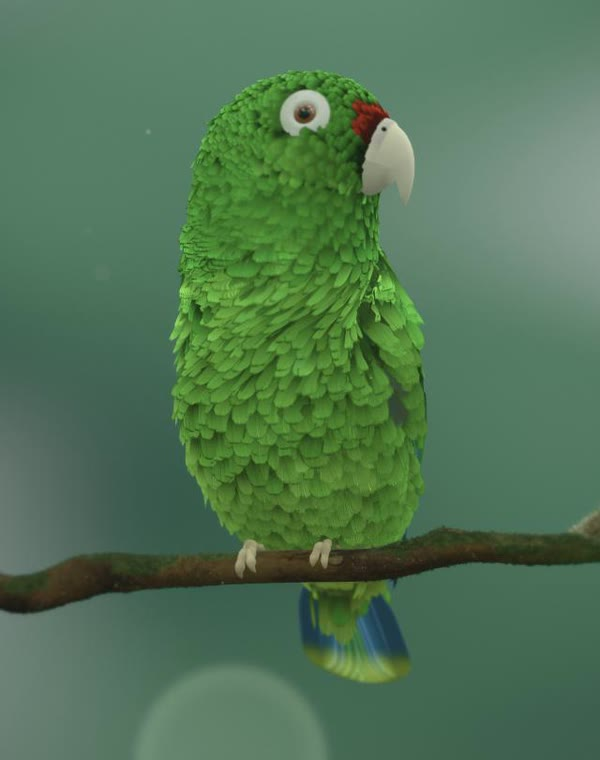
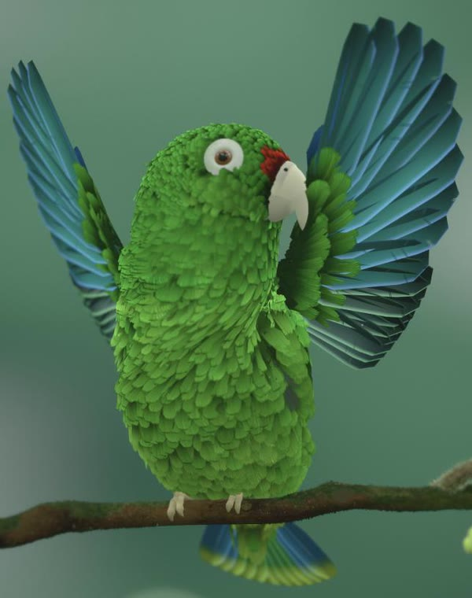

# Iguaca

The Iguaca, the Puerto Rican parrot (*Amazona vittata*), perched in a cloud forest. It is rigged and procedurally alive in three.js, and every feather is real geometry. It looks about, cocks its head, blinks, ruffles, calls, stretches a wing, and takes a palm fruit when you offer one.

**Live: https://webgpu-demos.github.io/iguaca/**

 

This is a remake of [12 Feather](https://github.com/ttillberg/codevember-2026/tree/main/12) from Theo Tillberg's Codevember 2026 (MIT). The rig, the pose solver, the feather shader and the scene are his; that day's bird was a hummingbird. The species, its anatomy, its behaviour and the setting were changed here.

## Try it

- **Click** anywhere to offer a sierra palm fruit. In reach, the bird takes it and chews.
- **Move the pointer** and it may look at it. **Drag** to orbit.
- **Space** startles it. **S** stretches: both wings raised over its back, then, the next time, one wing let down. **R** ruffles. **B** turns it round.
- The round button, bottom right, has the same actions, plus **Call** (with its sound) and **Forest sound** (off until you ask for it; see Sound below).
- **P** pauses, **D** runs a demo, **W** shows the drawing, **H** the head's wireframe.

Address flags: `?gem` shows the original hummingbird in its own scene, `?settings` shows the workbench card on a built page, `?clean` leaves the scene alone. For looking closely: `?pose=front|profile|back|three`, `?quiet`, `?spread=0..1`, `?jaw=0..1`, `?arousal=0..1`.

## Run

```sh
npm install
npm run dev        # http://localhost:5173
npm run typecheck
npm run build        # into dist/, runs from any folder
npm run build:pages  # into docs/, which GitHub Pages serves from the main branch
```

## Sound

**Call** is always heard: the bird calls with the voice of real Puerto Rican parrots. **Forest sound** turns the background on and off, a real recording of coquí frogs at night, and with it on you also hear the calls the bird makes by itself (see Credits below). If the background recording is removed, a coquí chorus made in the browser takes its place; with no call recordings the bird calls silently.

Recordings sit in `public/audio/` and are named in `public/audio/audio.json`:

```json
{
  "forest": ["coquies-hatillo.mp3"],
  "calls": ["call-1.mp3", "call-2.mp3"]
}
```

- `forest`: one background recording, a minute or more. It loops with a cross-fade, so it does not need to be cut to loop.
- `calls`: short parrot calls. One plays each time the bird calls, never the same one twice running.
- mp3 plays in every browser. Check each recording's licence before using it, and keep any credit it asks for here and in `public/audio/CREDITS.txt`, which ships with the build.

### Credits

- `coquies-hatillo.mp3`: "[Coquíes1](https://commons.wikimedia.org/wiki/File:Coqu%C3%ADes1.ogg)" by ValWey, a field recording of coquí frogs at night in Hatillo, Puerto Rico (2012), [CC BY-SA 3.0](https://creativecommons.org/licenses/by-sa/3.0/). Converted from Ogg Vorbis to MP3; shared under the same licence.
- `call-1.mp3` … `call-7.mp3`: Puerto Rican parrots calling in a release cage at Maricao, Puerto Rico, 30 November 2016, from the video "[VID-20161130-WA0005](https://www.flickr.com/photos/usfwssoutheast/31323774122)" by the U.S. Fish and Wildlife Service, Southeast Region. Public domain. Seven phrases cut from its sound track, faded, levelled and converted to MP3.

## How it is put together

- **The bird as data** (`src/bird/species.ts`): `IGUACA` holds the body's cross-sections, the feather tracts and their looks, the wing, tail and legs, and the tempo of its behaviour. `MOUNTAIN_GEM` is the original hummingbird.
- **Anatomy** (`src/bird/parts.ts`): the hooked bill, the short thick tongue, the two-forward two-back feet, the bare white eye ring, the brown iris and the pupil that pins. The bill hangs from eye level: the head's last cross-section is a slanted plane from the cere back to the chin, the upper mandible is an arch between its ridge and its cutting edge that turns over into the hook, and the lower is a short deep scoop behind it.
- **Feathers** (`src/bird/plumageGeometry.ts`, `plumageMaterial.ts`): each look can ask for a dark band along the free edge (`edge`) and a closed vane with a clean outline (`closed`). Together they give the scaled look of the head, neck and breast.
- **Wings and tail** (`wing.broad`, `tail` in `species.ts`): a broad rounded wing. Open, it is green coverts over a blue band, the primaries deep blue on the outer web and blackish inside and at the tip, the secondaries green ending blue; underneath it is an even blue-green. Folded, it is mostly coverts and green secondaries, with the primaries' dark ends beyond them. The tail is twelve separate green feathers ending in a yellow-green band, the outer ones edged blue.
- **Behaviour** (`src/bird/motion/*`): layers write a pose and a solver turns it into bones. `behaviour.parrot` switches the call, the chewing, the head cocking, the wing stretch, and switches off the hover flight.
- **Scene** (`src/main.ts`, `src/env/*`, `src/seeds.ts`, `src/sound.ts`): a cloud-forest backdrop with drifting mist, soft overcast light, the palm fruit, and the forest sound.

## Changed from 12 Feather

- A new species, with the anatomy, feather look, wings, tail, behaviour and scene above.
- Bugs fixed along the way: tone mapping "None" no longer breaks the grade shader; a held key does not repeat and Space on a focused button only presses the button; the pixel ratio follows browser zoom and a move to another screen; pointer rays follow the phone tilt; the settings card is hidden from visitors unless asked for.

## Still open

- The perch is the original mossy twig. A palo colorado limb is not modelled yet.
- Preening is switched off: it was written for a long bill and is untested with a short one.
- The bird does not feed from its foot, and it does not fly.
- The share image is a screenshot at screen size.
- The forest recording is a night chorus; the scene is daytime.

## Licence

MIT. Original work © 2026 Theo Tillberg; see `LICENSE`.
